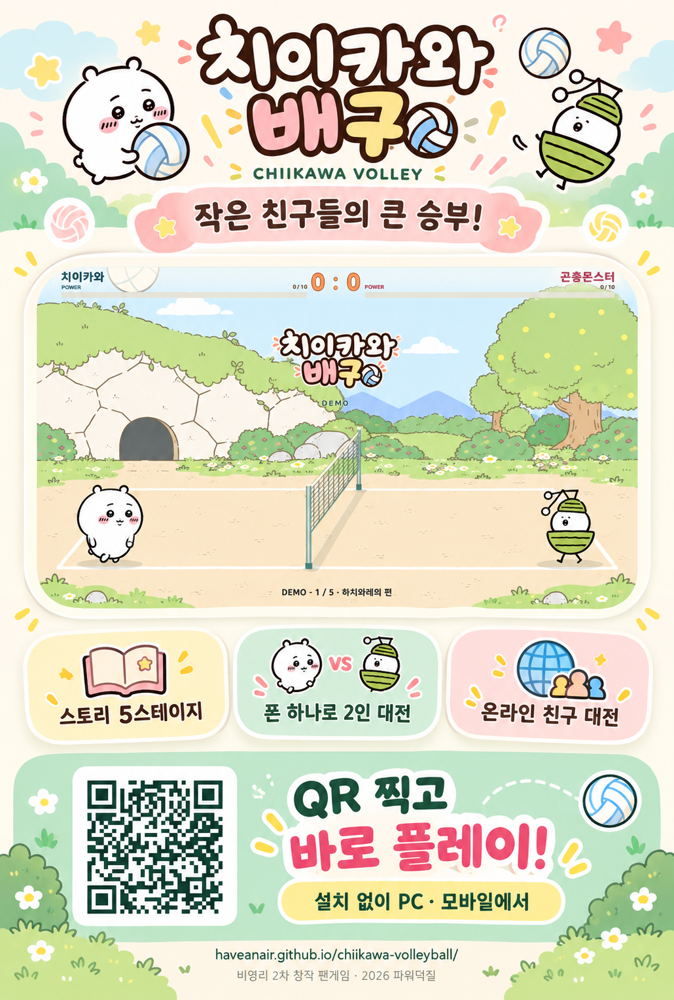

# 치이카와 배구 · Chiikawa Volley

**작은 친구들의 큰 승부!** 치이카와 친구들과 함께 즐기는 비영리 배구 팬게임입니다.

**[웹에서 바로 플레이](https://haveanair.github.io/chiikawa-volleyball/) · [GBA 다운로드](https://github.com/haveanair/chiikawa-volleyball/releases/tag/gba-v0.5.7) · [Switch 다운로드](https://github.com/haveanair/chiikawa-volleyball/releases/tag/switch-v0.7.9)**

## 현재 배포 버전

| 플랫폼 | 버전 | 실행 방법 | 대전 |
|---|---|---|---|
| 웹 | v0.56 | PC·모바일 브라우저에서 설치 없이 실행 | 같은 기기 2인 / CPU / 온라인 친구 대전 |
| GBA | v0.5.7 | GBA 에뮬레이터 또는 호환 환경에서 ROM 실행 | CPU / 케이블 통신 기능은 실기 미검증 |
| Switch 홈브류 | v0.7.9 | 홈브류 실행 환경에서 NRO 또는 NSP 사용 | 같은 기기 2인 / CPU, 온라인 미지원 |

GBA와 Switch는 **도전과제로 캐릭터를 해금하는 일반판**과 **14개 선택 캐릭터를 처음부터 사용할 수 있는 해금판**을 제공합니다. Switch 설치 이름은 일반판 **치이카와 배구**, 해금판 **치이카와 배구 · 해금버전**입니다. 타이틀 ID와 저장 파일이 달라 함께 설치할 수 있습니다.

## 게임 소개

- **5개 스토리 코트:** 하치와레의 집, 숲속, 마을, 인어섬, 세이렌의 동굴을 따라 대결합니다.
- **캐릭터별 상호작용:** 경기 전 대화와 짧은 음성, 표정·몸짓으로 친구들의 관계를 표현합니다. 원작을 참고한 게임용 각색입니다.
- **초필살기:** 공을 10번 튕겨 게이지를 채운 뒤 상단 스파이크를 맞히면 발동합니다.
- **개별 난이도:** 스토리와 CPU 대전 난이도를 각각 설정합니다.
- **오프닝과 데모:** 좌우 문구와 내려오는 로고, 캐릭터 대화와 CPU 랠리가 이어집니다.
- **한국어·영어:** 타이틀에서 변경합니다. 제작자 표기는 한국어 **2026 파워덕질**, 영어 **2026 PowerOtaking**입니다.

웹판은 치이카와·하치와레·우사기로 시작하고 도전과제로 친구를 해금합니다. 기록은 현재 브라우저에 저장되며 도전과제 메뉴의 **기록 백업 저장**으로 보관할 수 있습니다.

웹 경기 화면은 스위치 버전을 참고해 점수를 크게 표시하고, 필살 게이지를 짧고 굵게 배치했습니다. PC와 모바일 화면 크기에 맞춰 조절되며, 게이지는 양쪽 바깥에서 중앙 방향으로 채워집니다.

웹판은 실행할 때 스위치와 같은 세 친구·로고·분홍색 진행 막대의 로딩 화면을 보여줍니다. 게임 자료 준비를 마치면 오프닝과 타이틀로 이어지며, 불러오기에 실패하면 다시 불러오기 버튼을 표시합니다.

## 웹판 조작

| 동작 | 1P | 2P | 터치 |
|---|---|---|---|
| 좌우 이동 | A / D | ← / → | ◀ / ▶ |
| 점프 | W | ↑ | ▲ |
| 공격 | F | Enter | 공격 |
| 상단 스파이크 | W + F | ↑ + Enter | ▲ + 공격 |

**폰 하나로 2인 대전:** 게임 시작 → 2인 대전 → 두 캐릭터 선택. 가로 화면에서 왼쪽은 1P, 오른쪽은 2P 패드로 이동·점프·공격합니다. 여러 손가락 입력을 독립적으로 처리하며 전체 화면도 지원합니다.

가로 1인용은 방향키 68×68px, 공격 버튼 88×88px로 키워 엄지로 누르기 쉽게 조정했습니다. 세로 화면과 로컬 2인용 패드 배치는 유지합니다.

**CPU 대전:** 2인 대전에서 상대를 컴퓨터로 바꾸고 난이도·코트·캐릭터를 선택합니다. 컴퓨터가 2P를 조작합니다.

**온라인 친구 대전은 웹판에서 지원합니다.** 한 명이 방을 만들고 다른 사람이 숫자 4자리 방 번호로 참가한 뒤 방장이 시작합니다. 각자 자기 기기에서 1P 조작을 사용하세요. 두 사람 모두 최신 페이지를 사용해야 하며 통신망에 따른 지연은 발생할 수 있습니다.

## 이번 배포의 주요 변경

| 플랫폼 | 변경 내용 |
|---|---|
| 웹 v0.56 | 오프닝·타이틀 위치와 비율 통일, 타이틀 중앙 정렬, 제작자 영문 전환, 난이도 물음표 수정, 쿠리만쥬 대화 표정 크기 통일, 스위치처럼 큰 점수와 짧고 굵은 필살 게이지, 스위치와 같은 세 친구 로딩 화면 |
| GBA v0.5.7 | 오프닝 이식·반복 재생, 코트·네트 원근 정렬, 양 언어 점검, 문구 충돌 직후 점 노이즈 제거와 초기 화면 표시 보강 |
| Switch v0.7.9 | 일반판·해금판 분리, 이름·아이콘·설치 버전 정비, 독립 난이도, 시작 음성·다음 서브 표시, 온라인 메뉴 제외, 테스트판 고정 문구 제거, 해금 안내, 바깥에서 중앙으로 차는 게이지 |

## 다운로드와 공유

- [웹 v0.54 배포 안내](https://github.com/haveanair/chiikawa-volleyball/releases/tag/web-v0.54)
- [GBA v0.5.7 전체 ZIP·ROM](https://github.com/haveanair/chiikawa-volleyball/releases/tag/gba-v0.5.7) · [GBA 조작 안내](gba/README.md)
- [Switch v0.7.9 전체 ZIP·NSP·NRO](https://github.com/haveanair/chiikawa-volleyball/releases/tag/switch-v0.7.9) · [Switch 안내](switch/README.md)
- [새 소개 이미지 PNG](docs/promo/chiikawa-volley-promo-v54.png) · [QR PNG](docs/promo/chiikawa-volley-qr.png) · [인쇄용 QR SVG](docs/promo/chiikawa-volley-qr.svg)

릴리스의 **Assets**에서 실행 파일이나 전체 ZIP을 받으세요. GitHub가 자동 생성하는 **Source code ZIP은 실행용 패키지가 아닙니다.** 각 릴리스의 `SHA256SUMS.txt`로 파일을 확인할 수 있습니다. Switch 키 파일은 포함하지 않습니다.

소개 이미지의 QR은 웹게임으로 연결됩니다. 새 포스터는 기존 게임 이미지를 참고한 AI 편집 홍보 이미지이며 실제 게임 화면과 일부 표현이 다를 수 있습니다.

## English

**A little match with a big heart!** A non-commercial Chiikawa volleyball fan game for web browsers, GBA, and Nintendo Switch homebrew.

Five story courts, 14 roster slots, character encounters, special shots, and independent story/CPU difficulty. The browser version supports **two players on one phone**, CPU matches, and online friend matches with four-digit room codes. Switch supports local two-player and CPU matches; online play is not implemented. GBA cable play and Switch stability still need real-device verification.

Current releases: **Web v0.56 · GBA v0.5.7 · Switch v0.7.9**. GBA and Switch offer achievement-locked and all-unlocked variants. Select Korean or English on the title screen. Download playable files from release **Assets** and check them with `SHA256SUMS.txt`.

## 제작 및 원작 · Credits

제작 / Created by: **2026 파워덕질 / 2026 PowerOtaking**

캐릭터 원작 / Original characters: **나가노 · 치이카와 / Nagano · Chiikawa**

게임 기반 및 참고: **하모 아요 배구 GBA · 피카츄배구**

비영리 2차 창작 팬게임이며 공식 게임이 아닙니다. 캐릭터·이미지·음원의 권리는 각 권리자에게 있습니다. / This is an unofficial, non-commercial fan game. Characters, artwork, and audio belong to their respective rights holders.

하모 아요 코드의 MIT 고지는 [LICENSE-HAMO-MIT](docs/LICENSE-HAMO-MIT.txt)를 참고하세요.

저장소 구성: `docs/` 웹게임 · `shared/` 공통 C 경기 코어 · `gba/` GBA 안내 · `switch/` Switch 안내 · `server/` 웹 온라인 서비스 소스.
